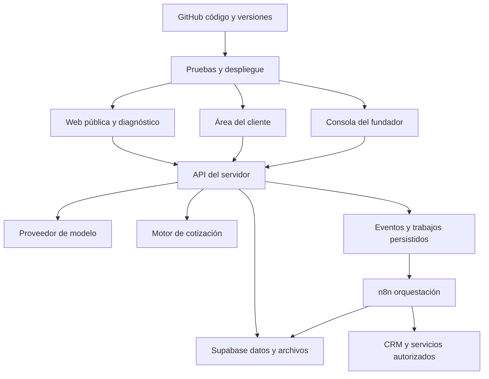

# Element999 especificación de producto y operación

Fecha: 21 de octubre de 2026. Versión: 0.2. Estado: Fase 1 validada por el fundador con tarifa de cálculo de 80 EUR/h. Los supuestos operativos se mantienen como base de planificación; el gasto requiere autorización específica.

Element999 debe convertir una necesidad empresarial poco definida en un diagnóstico, una propuesta explicable y una entrega coordinada. La primera versión debe demostrar ese recorrido con dos servicios repetibles y mantener el resto del catálogo disponible mediante diagnóstico y revisión.

El éxito se medirá por resultados y por la reducción de intervenciones del fundador. La autonomía comercial comenzará por información, diagnóstico y estimación; los compromisos definitivos y las acciones sobre sistemas de clientes tendrán límites explícitos.

## 1 Posicionamiento y público inicial

**Propuesta de valor:** encontramos el elemento que falta en tu negocio y lo convertimos en una ventaja operativa mediante software, datos e inteligencia artificial.

**Mensaje principal propuesto:** El elemento que falta para que tu empresa avance.

**Explicación:** identificamos fricciones en captación, ventas y operaciones, construimos la solución y medimos el cambio.

**Acción principal:** Encontrar mi elemento. Abre el diagnóstico, que también se puede completar mediante formulario.

**Acción secundaria:** Ver resultados. Abre casos con evidencia, contexto y alcance de la participación del fundador.

El tono será científico, preciso, serio y ambicioso. Las afirmaciones deben explicar qué cambia, cómo se comprueba y qué condiciones necesita. La web evitará garantías de ventas, rankings, rentabilidad o plazos que no pueda demostrar.

### Público prioritario propuesto

| Prioridad | Empresa y situación | Necesidad inicial | Oferta de entrada |
| --- | --- | --- | --- |
| 1 | Ecommerce con ventas y operación existentes | Captación dispersa, consultas repetidas, seguimiento manual | Landing o agente conectado a CRM |
| 2 | Empresa de servicios con proceso comercial digital | Oportunidades sin clasificar o responder | Agente de diagnóstico y seguimiento |
| 3 | Empresa con necesidad singular | Nuevo producto, integraciones complejas o transformación de procesos | Diagnóstico para proyecto a medida |

Se prioriza por problema y capacidad de implantación, sin asumir tamaños de empresa ni facturación que todavía no conocemos. La marca puede atender otras industrias sin convertir cada una en una línea de negocio independiente.

### Supuestos y decisiones pendientes

| Asunto | Base de trabajo | Momento de validación |
| --- | --- | --- |
| Mercado e idioma | B2B hispanohablante, español inicial | Antes de cerrar mensajes en Fase 2 |
| Moneda | EUR para modelar precios; tratamiento fiscal pendiente | Antes de activar cotizaciones en Fase 5 |
| Especialización | Ecommerce y operaciones comerciales digitales | Revisión de esta fase |
| Dominio | Sin seleccionar; Element999 es el nombre de trabajo | Antes del despliegue público |
| Identidad | Adjuntos originales, negro, blanco y verde eléctrico | Fase 2 |
| Casos y métricas | Sin casos documentados todavía | Fase 4 |
| Capacidad | Un fundador con apoyo de IA; 30 horas productivas semanales para estimar calendario | Antes de comprometer fechas |
| CRM | Registro mínimo de oportunidades en Supabase; un conector externo para el primer piloto | Fases 3 y 5 |
| Tarifas | Hipótesis internas de la sección 4 | Antes de publicar precios |
| Entidad, condiciones y facturación | Pendientes | Antes de contratar o cobrar en Fase 6 |

## 2 Alcance de la primera versión

### Tres superficies del producto

1. **Web pública:** inicio, soluciones, casos, método, diagnóstico y páginas de información empresarial necesarias para el lanzamiento.
2. **Área del cliente:** propuesta, aceptación cuando se habilite, incorporación, documentos, estado y entregables.
3. **Consola del fundador:** oportunidades, resúmenes, cotizaciones, conocimiento aprobado, proyectos, ejecuciones, bloqueos y costes.

El diagnóstico se podrá iniciar sin cuenta. Guardar una propuesta y consultar información privada requerirá identificación y verificación de acceso. La contratación de un servicio estándar podrá completarse por autoservicio cuando sus condiciones y proveedores estén configurados en la Fase 6.

### Incluido

- Presentación de todos los servicios mediante tres resultados empresariales.
- Casos verificables y una plantilla editorial reutilizable.
- Diagnóstico conversacional con memoria contextual autorizada y alternativa de formulario.
- Estimación reglada para dos ofertas estándar; clasificación y resumen para proyectos especiales.
- Gestión de oportunidades, propuestas versionadas y seguimiento.
- Dos plantillas de ejecución con criterios de aceptación y recuperación ante fallos.
- Métricas comerciales y operativas, control de accesos y documentación de operación.

### Fuera de la primera versión

- Marketplace, aplicación móvil, llamadas autónomas y omnicanalidad completa.
- Producción automática de cualquier software o integración solicitada.
- Entrenamiento continuo del modelo con conversaciones sin revisión.
- Despliegues autónomos en sistemas de clientes, campañas con gasto o cambios irreversibles sin autorización específica.
- Promesas de disponibilidad humana permanente o soporte ilimitado.

## 3 Catálogo comercial inicial

Los servicios se presentan como capacidades al servicio de un resultado. Cada proyecto elegirá una métrica de resultado y una métrica operativa; la atribución y el periodo de medición se acordarán según los datos disponibles.

| Línea | Capacidades | Resultado que se busca | Modalidad inicial |
| --- | --- | --- | --- |
| Vender más | Landings, webs comerciales, marketing, SEO y GEO | Mejor captación, conversión o descubrimiento | Landing estándar; resto a medida |
| Operar mejor | Agentes, CRM, automatizaciones e integración de datos | Menos trabajo manual y mejor seguimiento | Agente estándar; resto a medida |
| Construir productos | Ecommerce, software y herramientas internas | Nuevos canales o capacidades de negocio | Proyecto a medida |

### Oferta A Landing de captación

**Problema:** una oferta necesita un destino claro que convierta visitas en oportunidades identificables.

**Incluye:** una página con hasta ocho secciones, un idioma, adaptación móvil, estructura de contenido, un formulario, un destino CRM con conector validado, eventos de conversión y configuración técnica básica de búsqueda. Usa un sistema visual definido y contenido o materiales autorizados. Incluye dos rondas consolidadas de revisión.

**Excluye:** tienda, área privada, identidad de marca completa, compra de medios, traducción profesional, migraciones y garantías de conversión. El dominio, las suscripciones y las licencias se presupuestan aparte.

**Dependencias:** oferta definida, materiales y permisos, acceso al destino CRM y dominio cuando corresponda.

**Aceptación:** página aprobada en móvil y escritorio, formulario probado hasta el CRM, eventos comprobados y ausencia de fallos críticos. Se documenta la prueba de rendimiento y los recursos que la condicionan.

**Planificación provisional:** 20 horas base y 5–8 días laborables desde requisitos completos y disponibilidad confirmada. Las horas son una hipótesis de esfuerzo; los días incluyen revisión y coordinación.

### Oferta B Agente comercial conectado a CRM

**Problema:** las consultas llegan sin estructura y requieren atención repetitiva antes de convertirse en oportunidades útiles.

**Incluye:** agente web en español, una base aprobada de hasta 30 documentos de texto y 200 páginas totales, hasta tres rutas de diagnóstico, un CRM con conector validado, resumen estructurado, derivación y panel básico de incidencias. Los documentos deben permitir extracción de texto; se excluye OCR complejo. Incluye dos rondas consolidadas de ajuste y evaluación.

**Excluye:** voz, WhatsApp, múltiples CRM, migraciones, entrenamiento de modelos, bases documentales abiertas y acciones transaccionales autónomas. Las APIs, mensajería y alojamiento son recurrentes separados.

**Dependencias:** conocimiento aprobado, campos del CRM, credenciales por canal seguro y política comercial.

**Aceptación:** supera los escenarios acordados, registra cada oportunidad una sola vez, conserva aislamiento de datos, deriva la información insuficiente y entrega el resumen al canal definido.

**Planificación provisional:** 40 horas base y 10–15 días laborables desde requisitos completos y disponibilidad confirmada.

### Ofertas a medida

Ecommerce, webs con múltiples páginas, software, CRM avanzado, marketing, SEO/GEO y automatizaciones fuera de las plantillas generan un diagnóstico y una propuesta revisada. El agente explica las variables de alcance y el siguiente paso; no extrapola automáticamente los precios de las ofertas estándar.

### Mantenimiento y cambios

Se separan tres conceptos: corrección de defectos del alcance aceptado, operación recurrente y nuevas funciones. Hipótesis: 30 días de corrección de defectos tras la aceptación; cambios de alcance generan nueva estimación. Las condiciones definitivas se validan antes de contratar.

La operación recurrente se cotiza con volumen, horas de soporte incluidas, horario, tiempos de respuesta y costes de terceros. Las solicitudes fuera de esos límites entran en una cola de cambios. La plataforma muestra el estado y los requisitos pendientes para reducir contactos repetidos.

## 4 Reglas de cotización preliminar

### Modelo económico interno propuesto

La tarifa de cálculo de 80 EUR/h ha sido validada por el fundador. Los rangos siguientes aplican esa tarifa al alcance definido; todavía no están publicados y no representan una comparación con precios de mercado.

- Coste interno supuesto: 55 EUR por hora de trabajo, incluyendo el tiempo del fundador.
- Margen bruto de referencia sobre trabajo con la tarifa validada: (80 − 55) / 80 = 31,25 %, antes de gastos generales, impuestos y captación.
- Tarifa de cálculo validada: 80 EUR/h. El coste interno supuesto de 55 EUR/h se mantiene separado de la tarifa comercial.
- Moneda inicial: EUR. La estimación muestra impuestos pendientes de determinar y costes externos separados.
- Vigencia propuesta: 15 días naturales; disponibilidad confirmada al formalizar.
- Cobro propuesto para alcance fijo: 50 % al inicio y 50 % en la aceptación. Su implementación corresponde a Fase 6.

### Variables y fórmula

| Variable | Regla propuesta |
| --- | --- |
| Horas base | Landing: 20; agente: 40 |
| Segundo idioma | +4 h, solo landing con traducción aportada |
| Integración adicional validada | +8 h por integración; máximo una adicional en la estimación estándar |
| Migración, API sin validar, datos sensibles o alcance abierto | Revisión; sin precio estándar automático |
| Urgencia | Multiplicador 1,25; siempre revisión de capacidad |
| Incertidumbre acotada | Rango superior con reserva del 15 % |
| Costes externos | Líneas separadas, con fuente, fecha y responsable del pago |

Precio de referencia = (horas base + extras compatibles) × 80 × multiplicador de urgencia.

Rango preliminar = [redondeo hacia arriba a 50 EUR del precio de referencia; redondeo hacia arriba a 50 EUR del precio de referencia × 1,15].

La reserva del 15 % cubre incertidumbre acotada. No permite suplir información crítica desconocida. El precio fijo final se decide dentro de ese rango tras confirmar alcance; cambios posteriores se versionan y aceptan por separado.

### Ejemplos comprobables

| Solicitud | Cálculo | Rango preliminar sin impuestos ni terceros | Tratamiento |
| --- | --- | --- | --- |
| Landing estándar | 20 × 80 = 1.600 | 1.600–1.850 EUR | Automático si requisitos completos |
| Landing con segundo idioma aportado | 24 × 80 = 1.920 | 1.950–2.250 EUR | Automático si requisitos completos |
| Agente estándar | 40 × 80 = 3.200 | 3.200–3.700 EUR | Automático si requisitos completos |
| Agente con integración adicional validada | 48 × 80 = 3.840 | 3.850–4.450 EUR | Automático dentro de los límites |
| Landing urgente | 20 × 80 × 1,25 = 2.000 | 2.000–2.300 EUR | Revisión de capacidad |
| Ecommerce con migración | Alcance sin definir | Sin estimación automática | Diagnóstico y revisión |

Para una landing base de 1.600 EUR, el coste de trabajo supuesto es 1.100 EUR y el margen sobre ese trabajo es 31,25 %. Si consume 30 horas, el coste alcanza 1.650 EUR y el margen cae al −3,125 %. Se registrarán horas y consumo real para corregir las bases tras los primeros proyectos.

### Reglas del motor

1. El modelo extrae variables; el servidor valida tipos, límites y compatibilidad de extras.
2. Una función determinista calcula precio, reserva y redondeo. El modelo no inventa descuentos, tarifas o multiplicadores.
3. Sin objetivo, entregable, idioma, integraciones y restricciones mínimas, se presenta un diagnóstico provisional y los datos pendientes.
4. La cotización guarda versión del catálogo, entradas confirmadas, fórmula, fecha, exclusiones y estado.
5. La estimación no reserva agenda, contrata ni cobra. Solo una propuesta final aceptada activa el flujo correspondiente.
6. No se publica una fecha si la capacidad y las dependencias no están comprobadas.

## 5 Experiencia comercial y estados

| Paso | Experiencia del cliente | Registro o salida | Excepción |
| --- | --- | --- | --- |
| Descubrir | Comprende una oferta y consulta un caso | Evento de visita y origen | Sin caso relevante, mostrar método |
| Diagnosticar | Describe su necesidad con sus palabras | Objetivo, contexto, restricciones | Formulario si el chat falla |
| Confirmar | Corrige un resumen breve | Hechos confirmados y pendientes | No convertir inferencias en hechos |
| Estimar | Recibe rango y alcance o motivo de revisión | Cotización versionada | Fuera de catálogo, revisión |
| Guardar | Verifica acceso a su propuesta | Oportunidad y contacto | Sin contacto, resumen descargable |
| Contratar | Revisa propuesta final y condiciones | Aceptación y pago si procede | Bloqueo por requisitos comerciales |
| Incorporarse | Aporta documentos y accesos solicitados | Lista de requisitos completa | Proyecto pendiente de requisitos |
| Seguir | Consulta estado, bloqueos y entregables | Historial del proyecto | Incidencia con responsable |
| Aceptar | Comprueba entrega contra lo pactado | Aceptación o defecto documentado | Cambio de alcance separado |

Estados comerciales: nueva → diagnóstico incompleto → cualificada → estimada o en revisión → propuesta final → aceptada o perdida. El abandono no equivale a rechazo.

Estados de producción: pendiente de requisitos → lista para programar → en producción → en verificación → pendiente de aceptación → entregada → en mantenimiento o cerrada. Un bloqueo conserva el estado anterior y registra causa, responsable y fecha.

### Resumen que recibirá el fundador

Empresa y contacto si se facilitan; objetivo y problema; proceso y herramientas actuales; servicio sugerido y motivo; datos confirmados e inferidos; presupuesto declarado si existe; plazo deseado; integraciones; alcance y exclusiones; precio y versión de reglas; riesgos; información pendiente; siguiente acción.

La clasificación describe necesidades operativas. No deduce solvencia, atributos sensibles ni presupuesto a partir de la apariencia del negocio. Si no se declara un presupuesto, lo registra como desconocido.

## 6 Autonomía y conocimiento

| Acción | Grado inicial | Condición |
| --- | --- | --- |
| Explicar servicios y casos | Automático | Conocimiento aprobado y trazable |
| Diagnosticar y resumir | Automático | Identificar dudas y confirmar resumen |
| Calcular rango estándar | Automático | Variables validadas y reglas vigentes |
| Guardar oportunidad y actualizar estado | Automático | Identidad y permisos adecuados |
| Seguimiento comercial | Automático tras configuración | Preferencias de contacto y reglas aprobadas |
| Propuesta definitiva estándar | Revisión durante el piloto | Automatizable tras validar precios y resultados |
| Propuesta a medida, urgencia o descuento | Revisión del fundador | Decisión registrada |
| Generar borradores de contenido o código | Automático dentro de un proyecto | Alcance y presupuesto de ejecución |
| Publicar en sistemas del cliente o activar gasto | Autorización específica | Destino, acción y límites definidos |

El agente usa memoria de la conversación y, cuando proceda, del proyecto autorizado. Las respuestas del cliente no modifican el catálogo ni la base global. Las mejoras de conocimiento pasan por revisión, versión y evaluación. Las instrucciones encontradas en documentos o mensajes de clientes se tratan como contenido, sin capacidad para cambiar permisos o reglas de negocio.

Durante el piloto se mide qué excepciones son frecuentes. Solo se automatiza una decisión adicional cuando tiene reglas claras, ejemplos de prueba y una vía de recuperación.

## 7 Arquitectura propuesta

### Responsabilidad de cada herramienta

| Herramienta | Papel | Límite |
| --- | --- | --- |
| Lovable | Prototipo y construcción de interfaces | La lógica comercial sensible vive en servidor |
| GitHub | Código, revisiones, migraciones y automatizaciones versionadas | Los secretos se almacenan fuera del repositorio |
| Supabase | Datos, autenticación, archivos y autorización | Separación por organización y permisos mínimos |
| n8n | Flujos, integraciones, tareas y gestión de errores | El estado comercial autoritativo se conserva en la base de datos |
| API de modelo por seleccionar | Interpretación y generación con salida estructurada | Sin acceso ilimitado a datos o acciones |
| Claude y ChatGPT como herramientas de trabajo | Producto, contenido y desarrollo asistido | Uso interactivo distinto del runtime de producción |
| Gemini y Higgsfield | Recursos visuales específicos | Generación fuera del recorrido crítico de carga |

La integración de Lovable permite sincronizar código con GitHub; se usará para mantener una copia revisable y facilitar el trabajo local. [Documentación de Lovable](https://docs.lovable.dev/integrations/github).

### Modelo de datos conceptual

| Entidad | Campos o relaciones principales |
| --- | --- |
| organizations y memberships | Organización, usuario, rol y estado de acceso |
| leads y contacts | Organización asociada cuando exista, origen, etapa y preferencias |
| conversations y messages | Propietario de sesión, mensajes, fecha y política de conservación |
| diagnoses | Hechos, inferencias, pendientes, confirmación y versión |
| service_versions y pricing_rules | Alcance, bases de esfuerzo, extras y vigencia |
| quotes y quote_items | Diagnóstico, reglas usadas, importes, estado y versión |
| acceptances y payment_references | Propuesta aceptada, evidencia y referencias del proveedor |
| projects, tasks y deliverables | Alcance congelado, dependencias, estado y aceptación |
| knowledge_documents | Fuente, versión, visibilidad y aprobación |
| jobs, executions y audit_events | Evento, clave de duplicación, intentos, resultado y actor |

Las conversaciones anónimas se aíslan mediante sesión gestionada en servidor. Su vinculación a una cuenta exige comprobar identidad y pertenencia; no se conceden permisos por conocer un correo o un identificador. Toda entidad privada tendrá una política de acceso directa o derivada de su organización.

### Datos y fiabilidad

- Políticas de filas y privilegios mínimos para datos expuestos; pruebas de acceso entre dos organizaciones. Las claves de servicio permanecen en servidor. [Documentación de Supabase](https://supabase.com/docs/guides/database/postgres/row-level-security).
- Un cambio que deba iniciar trabajo guarda también su evento en una transacción. Un despachador entrega a n8n; los consumidores verifican una clave única y el estado antes de actuar.
- Los reintentos se limitan a fallos transitorios. Antes de repetir una acción externa de resultado incierto se consulta su estado o se deriva a revisión. Se conserva una cola de fallos que permite reanudar sin duplicar efectos.
- n8n dispone de flujos de error; se configurarán para registrar contexto y alertar sobre fallos que requieran actuación. [Documentación de n8n](https://docs.n8n.io/flow-logic/error-handling/).
- Límites por sesión y proyecto para solicitudes, duración, tokens y coste. Si se agota el presupuesto o falla el proveedor, se conserva el progreso y se ofrece formulario o revisión.
- Los archivos de un cliente solo se recuperan para sus tareas. El conocimiento público aprobado se almacena separado del conocimiento privado.
- Hipótesis de conservación para revisión: 30 días para sesiones anónimas abandonadas y 90 días para registros técnicos depurados. Propuestas, proyectos y documentación empresarial tendrán políticas propias definidas antes del lanzamiento. No se guardarán secretos ni mensajes completos en analítica.
- Copias de base de datos y de archivos con procedimiento separado, y prueba de restauración antes del piloto. Entornos de desarrollo usan datos ficticios o anonimizados.

La referencia MKT Hackers orienta el concepto de recorrido guiado y construcción automatizada. La observación pública anterior no verifica su backend; esta arquitectura es una propuesta propia para Element999.

## 8 Experiencia visual y casos

Los adjuntos definen la dirección inicial. El logotipo horizontal identifica la marca; el emblema inspira el icono. En Fase 2 se producirán derivados optimizados, preservando los originales. El favicon necesitará simplificación y comprobación a 16 y 32 píxeles; reducir directamente el emblema con todos sus efectos puede perder legibilidad.

La interfaz combinará fondos negro y grafito, texto claro y acentos verdes. La precisión vendrá de la jerarquía, las cifras contextualizadas y la explicación del proceso. Los recursos luminosos se concentrarán en puntos de atención y estados.

La animación explicará el paso de un dato o proceso fragmentado a una solución conectada. Se usarán transiciones breves, alternativas de movimiento reducido y carga diferida de multimedia. El contenido y la navegación funcionarán sin animación.

Cada caso recogerá cliente o sector autorizado, problema, periodo, situación inicial, intervención, participación del fundador, resultado, método de medición y permisos. Los proyectos anteriores se atribuirán correctamente como experiencia del fundador cuando precedan a Element999. Sin evidencia de una cifra, se describe el entregable comprobable. Una demostración se identifica como demostración.

## 9 Métricas y aceptación del producto

Las metas siguientes son hipótesis para el piloto; se publicarán siempre los denominadores y los periodos de observación.

| Métrica | Definición | Objetivo inicial |
| --- | --- | --- |
| Diagnóstico autónomo | Diagnósticos estándar completados con resumen y estimación sin intervención / diagnósticos estándar con datos mínimos | Al menos 80 % |
| Exactitud de precios | Estimaciones que coinciden con las reglas / estimaciones evaluadas | 100 % en pruebas |
| Integridad comercial | Casos con compromisos o resultados inventados | Cero en pruebas y piloto |
| Tiempo de primera respuesta | Tiempo desde envío hasta primera respuesta útil | p95 menor o igual a 5 s en condiciones de prueba definidas |
| Tiempo hasta estimación | Tiempo desde variables mínimas confirmadas hasta estimación visible | p95 menor o igual a 30 s |
| Intervención del fundador | Número de intervenciones y minutos por oportunidad y proyecto | Medir base y reducir por iteración |
| Margen real | Ingreso neto de impuestos menos costes directos, dividido por ingreso neto | Referencia 31,25 % sobre trabajo a tarifa base; medir también margen total |
| Fiabilidad | Acciones duplicadas y fallos pendientes de recuperación | Cero duplicados; fallos trazables |
| Rendimiento web | LCP, INP y CLS | ≤2,5 s; ≤200 ms; ≤0,1, respectivamente |

La conversión comercial se medirá por visita → inicio → diagnóstico completo → propuesta → aceptación. No se fija una mejora porcentual sin tráfico y línea base. Tres a cinco clientes de piloto validan recorrido y operación; no constituyen evidencia estadística suficiente de conversión o autonomía. La evaluación del agente empieza con al menos 30 escenarios, incluidos casos incompletos, fuera de catálogo, contradictorios y maliciosos.

Las dos ofertas de ejecución deberán superar pruebas de aceptación, un fallo de integración y una recuperación sin duplicados. Los objetivos de rendimiento se comprobarán en laboratorio y se contrastarán con datos reales cuando haya tráfico suficiente.

## 10 Cierre de la Fase 1

La definición de producto, catálogo, cotización, recorrido, autonomía, arquitectura, métricas y backlog están documentados. No hay infraestructura desplegada, precios publicados ni conexiones activadas.

El fundador ha validado esta fase con un único ajuste: tarifa de cálculo de 80 EUR/h. Quedan registradas estas decisiones:

1. Priorizar ecommerce y operaciones comerciales digitales en la captación inicial.
2. Usar landing y agente conectado a CRM como primeras plantillas de cotización y ejecución.
3. Aplicar la base de 80 EUR/h a los rangos, manteniendo los límites y las condiciones definidos.
4. Mantener capacidad y presupuesto como supuestos de planificación; comprobar disponibilidad y autorizar gasto antes de comprometer fechas o activar servicios.

Los datos de casos se incorporarán en Fase 4; los datos empresariales y condiciones definitivas, antes de contratación en Fase 6. Estos pendientes no impiden evaluar el producto ni preparar su dirección visual.

Con esta especificación validada, la Fase 2 comenzará con identidad digital, mapa de pantallas y prototipo del recorrido inicio → diagnóstico → estimación. La construcción y las conexiones se ejecutarán en sus fases respectivas.
